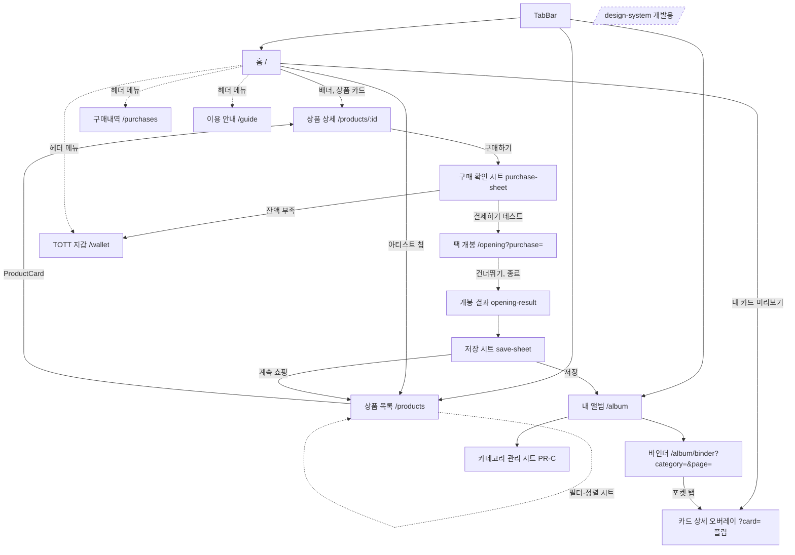

# 토마톡 포토카드 서비스: 페이지 구성(IA) · 디자인 시스템 · 컴포넌트 계획

> **상태: 검토용 초안 (DRAFT v0.2, 2026-10-06 KST)**
> 이 문서는 기획 문서입니다. 코드, GitHub(푸시·댓글·이슈) 변경은 없습니다.
> 진행 순서: **사용자 승인 → 구현.** 승인 전에는 구현하지 않습니다.
> 결정이 필요한 곳은 모두 **`[결정 Dn]`** 으로 표시했고, 8장에 모아 두었습니다.
>
> **2026-10-06 사용자 결정:** `TOMATOK_PHOTO_CARD_MYSTERY_ARCHIVE_PLAN_DESIGN_SYSTEM.md`에서는 **토큰만** 가져옵니다. 화면 흐름·카피·등급 종류·통화·저장 방식은 기존 PR-B(이 문서 1장·6장)를 유지합니다. SECRET 등급, 미보유 실루엣, 5팩 구매, 원화 표기, PC 바인더, `MY ARCHIVE` / `UNVEIL YOUR STAR` 카피는 넣지 않습니다.

- 읽은 기준(읽기 전용):
  - PR #7 `cursor/photocard-service-a-eaa7` @ `3e81860`
  - PR #10 `cursor/photocard-binder-album` @ `2a9d014` (draft, base = PR #7 브랜치)
  - PR #2 `cursor/feat-remotion-legendary-open-5d63` @ `75556f6`
  - Issue #6, #8, #9, #11
- 합친 문서:
  - `photocard-product-detail-purchase-plan.md` (PR-B, Issue #11): 구매·개봉·저장 흐름은 그대로 둡니다. **상세 화면 레이아웃(그 문서 1장)은 이 문서 6.2로 대체**합니다.
  - `photocard-card-flip-motion-plan.md` (플립·모션 감사): PhotoCard 핵심 컴포넌트와 플립 스프링, PR #10 버그 2개로 반영했습니다. UI 시간 토큰(120/200/320ms)은 아래 아카이브 문서를 따릅니다.
  - `TOMATOK_PHOTO_CARD_MYSTERY_ARCHIVE_PLAN_DESIGN_SYSTEM.md`: **컬러·서피스·보더·라디우스·타이포·간격·글로우·모션 시간만** 반영합니다. 그 문서의 화면 기획(2–12, 29, 34장)은 따르지 않습니다.
- 지켜야 할 원칙:
  - `service/`만 변경합니다.
  - 새 이미지를 만들지 않습니다(기존 에셋만 씀).
  - `src/vendor/PhotoCard.tsx`는 PROVENANCE 해시로 추적되므로 수정하지 않습니다.
  - 새 npm 의존성은 0개를 목표로 합니다(예외는 [결정 D6] 폰트).
  - 통화는 TOTT이고 목업·테스트 데이터만 씁니다. 실결제는 없습니다.

---

## 0. 현재 코드 → 제안 매핑 (요약)

| 영역 | 현재 (PR #7 / #10) | 문제 | 제안 |
|---|---|---|---|
| 테마 | `src/theme/tokens.ts`: `colors{ink #1C1410, paper #F6EFE6, mist, gold #C9A06A, line}`, `frames`, `rarities`(N/R/SR/SSR foil·glow), `CARD_RATIO=55/85`. 화면마다 `#0C0908`, `rgba(246,239,230,.1)` 같은 값을 직접 씀 | 단계(elevation)·타이포·간격 토큰이 없고 값이 흩어져 있음. 배경이 갈색 톤 | `src/ds/tokens.ts`(신규)에 네이비 무채색 + 등급색 토큰을 정의합니다(3.1). 골드 프라이머리는 쓰지 않습니다. 기존 `theme/tokens.ts`는 **삭제하지 않습니다**(vendor PhotoCard가 import). 등급은 N/R/SR/SSR만, 색 값만 교체합니다 |
| 바인더 테마 | PR #10 `binderTheme.ts`: 크림 속지 `#F4EBDC`, 커버 `#2A1F19→#120D0B` | 블랙 배경과 톤이 다름 | [결정 D5] |
| 루트 레이아웃 | `app/_layout.tsx`: `maxWidth: 360` 고정, `TestModeBanner` | 390/430 폭에서 양옆이 비어 보임 | 360–480px 유동 폭 [결정 D4] |
| 탭바 | `(tabs)/_layout.tsx`: 이모지 아이콘(🏠📦🎴) | 일관성이 떨어짐 | `TabBar` 토큰화. 아이콘 방식은 [결정 D7] |
| 상품 카드 | `components/ProductCard.tsx` 1종(이미지 0.7 비율, 아티스트, 앨범, 가격), `SaleBadge` | 홈 가로 레일과 목록 그리드가 같은 스타일. 등급·종수·랜덤 정보가 없음 | `ProductCard` variant `grid / rail / row` |
| 상품 목록 | `ProductListScreen.tsx`: 검색 + 칩 3줄(아티스트/앨범/정렬), FlatList 2열 | 칩 줄이 3개라 첫 화면의 40%를 차지함. 등급 필터가 없음 | `SearchField` + `FilterBar`(가로 1줄) + `SortSheet` + `ProductGrid` |
| 상품 상세 | `ProductDetailScreen.tsx`: 히어로 300px, 구성 카드 70×95, 확률표, 하단 버튼, 구매는 `alert` | 커버와 앞면이 같은 사진. 상품 정보 행이 없음 | 6.2 스펙 (PR-B 레이아웃 + 컴포넌트화) |
| 포토카드 | `vendor/PhotoCard.tsx`: 드래그 틸트, 마운트 spring, 등급 foil·glow가 있지만 **쓰는 곳이 없음**. PR #10 `FlipCard.tsx`만 플립(400ms linear, 틸트 꺼짐, 반짝임·떠다님 없음) | 플립·틸트·반짝임이 한 컴포넌트에 모여 있지 않음 | **DS 핵심 `PhotoCard`** (4.4, 5.2) |
| 배지 | `SaleBadge`(출시 예정·품절·판매 종료), PR #10 `RarityBadge`, `SupplyTag`(공급 종료), `CountBadge` | 색과 크기가 제각각 | `Badge` atom 하나로 통합 |
| 앨범 | PR #7 `AlbumScreen`(그리드), PR #10 바인더(`BinderHomeScreen`, `BinderScreen`, `Pocket`, `CardDetailOverlay`) | **버그 2개**: ① 2×2가 아니라 1열(그리드 280 < 2×138+12=288) ② 상세가 안 닫힘(`delete params.card` 후 `setParams` 병합) | 구현 0단계에서 수정 (7장) |

### 재사용 에셋 (새 이미지 0개)
- 사진(카드 앞면, 앨범 커버): `service/assets/photos/01.jpg` ~ `07.jpg` (576–736 × 920–1024)
- 카드 뒷면: `service/assets/fx/card_back.png` (230×375, PR #2 `motion/public/fx/card_back.png`와 같은 파일)
- 팩: `fx/pack_closed.png`, `pack_body_torn.png`, `pack_top_2.png`, `pack_top_3.png`, `pack_top_4.png`
- 효과: `fx/sparkles.png`, `sparkle_trail.png`, `light_flash.png`, `inner_glow.png`, `ring_effect.png`, `particles.png`, `ember_burst.png`
- `fx/card_front.png`는 참조하지 않습니다(PR-B 규칙 유지).
- 주의: `photos/*`는 실제 인물 사진입니다(Issue #6 결정 2). 공개 프리뷰 사용 여부는 이미 결정된 상태로 봅니다.

---

## 1. 서비스 페이지 구성 (사이트맵)



- 메인 탭은 3개(홈, 상품, 내 앨범)로 유지합니다(Issue #6). 지갑, 구매내역, 이용 안내는 헤더 메뉴(`HeaderMenu`)에서 들어갑니다.
- 알림 페이지는 만들지 않습니다. 개봉하지 않은 팩 안내는 홈 상단 `NoticeBanner`로 충분합니다. [결정 D9]
- `/design-system` 화면은 개발·검수용입니다. 탭에는 노출하지 않고 URL로만 들어갑니다.

### 페이지별 목적, 섹션(위→아래), 사용 컴포넌트

| 페이지 | 목적 | 섹션 (위→아래) | 컴포넌트 |
|---|---|---|---|
| 홈 | 신상품과 이어서 할 일 | Header(로고, 잔액 Price, 메뉴) → NoticeBanner(미개봉 N팩) → HeroBanner 캐러셀 → SectionHeader "추천" + ProductCard rail → "신규" rail → 아티스트 칩 → "내 카드" PhotoCard mini 4장 | Header, NoticeBanner, BannerCarousel, SectionHeader, ProductCard(rail), Chip, PhotoCard(size xs, static) |
| 상품 목록 | 찾기와 비교 | Header "상품" → SearchField → FilterBar(아티스트·앨범·등급·판매중, 정렬 버튼) → 결과 수 + 적용 필터 Chip → ProductGrid 2열 → Empty/Error | SearchField, FilterBar, Chip, SortSheet, FilterSheet, ProductGrid, ProductCard(grid), EmptyState, Skeleton |
| 상품 상세 | 구성 확인 후 구매 결정 | 6.2 참조 | ProductDetailHero, PhotoCard, InfoRow, ComponentsList, LineupGrid, OddsTable, NoticeAccordion, StickyBuyBar |
| 구매 확인 시트 | 테스트 결제 확인 | 상품 요약 → 가격, 현재 잔액, 결제 후 잔액 → **확률 요약(OddsTable compact)** → "테스트 결제" 문구 → 결제하기/취소 | BottomSheet, Price, OddsTable(compact), Button |
| 팩 개봉 | 개봉 연출 | 전체 화면 모션(PR #2 포팅) → 건너뛰기 | PackOpening(RN Animated), IconButton(skip) |
| 개봉 결과 | 뽑은 카드 공개 | PhotoCard(lg, 등장 shine) → 등급 Badge, NEW → 카드명 → 저장 시트 | PhotoCard, Badge, SaveSheet |
| 저장 시트 | 저장 위치 선택 | 기본 앨범 라디오 → 카테고리 라디오 → + 새 카테고리 입력 → 저장 | BottomSheet, RadioRow, TextField, Button, Toast |
| 내 앨범 홈 | 보유 현황 | 앨범 커버 타일(기본 앨범 + 카테고리, 보유 수) → 최근 획득 4장 → 앨범 열기 | AlbumCoverTile, PhotoCard(xs), Button |
| 바인더 | 실물 바인더 느낌의 열람 | FilterBar(아티스트·등급) → BinderGrid 2×2 + 링 → PageIndicator | BinderGrid, Pocket, CountBadge, Badge, PageIndicator |
| 카드 상세 (오버레이) | 확대·플립 | 닫기 → PhotoCard(lg, 플립·틸트·shine) → 등급, 획득일, 보유 수 → 카테고리 이동(PR-C) | Overlay, PhotoCard, InfoRow, Button |
| 카테고리 관리 (PR-C) | 만들기, 이름 변경, 삭제 | 타일의 ⋯ 메뉴 → 액션 시트 → 확인 다이얼로그 | ActionSheet, TextField, Dialog |
| TOTT 지갑 / 구매내역 | 테스트 잔액과 내역 | 잔액 카드(`bg.raised`, `border.default`) → 거래 리스트 | Price, ListRow, Badge |
| /design-system | 시각 검수 | 토큰 → 타이포 → 버튼 → 배지 → 카드 → 시트 | 전부 |

---

## 2. 리서치: 일반적인 포토카드·앨범 상품 정보

| 항목 | 일반적인 표기 | 우리 서비스에서 (디지털 팩, 목업) | 출처 |
|---|---|---|---|
| 구성품 | 포토북 96p/120p, CD-R, 엽서 "6종 중 랜덤 1종", 스티커, 접지 포스터 "2종 중 랜덤 1종", 포토카드 "6종 중 랜덤 1종" | 디지털 팩: 포토카드 1장(N종 중 랜덤), 카드 뒷면, 앨범 저장 | [W1][W2] |
| 포토카드 규격 | W55 × H85 mm (일부 54×86) | 55 × 85 mm. `CARD_RATIO`와 같음 | [W3][K1][P1] |
| 마감 | 무광, 유광, 홀로그램(레인보우·별·스파클), 프리즘 | **등급별 마감 표기**: N 무광, R 유광, SR 홀로, SSR 골드 홀로 [결정 D8] | [P1][P2] |
| 버전 | "6 Versions", Photobook Ver., Package Ver., Random Ver. | `version` 필드(예: "Photobook Ver.") | [W1][K1] |
| 발매일·입고일 | Release 2025-03-14, (Expected) Date of stock | 발매일, 판매 기간(`saleStartAt~saleEndAt`) | [K1] |
| 랜덤 고지 | "랜덤 구성품은 동일한 확률로 구성" | 등급별 확률을 **백분율로** 공개(동일 확률이 아님) | [W2][L1] |
| 유의사항 | 아웃박스 훼손 교환 불가, 측정 오차, 화면과 실제 색상 차이, 특전 카드의 미세 스크래치 | 화면 색상 차이, 디지털 상품 특성, 테스트 데이터 고지 | [W2][K2] |
| 한정·특전 | 초회 한정, 예약 특전 "7종 중 3종 랜덤", 소진 시 조기 종료 | `limited`, `perk` (선택, 후속) | [W4][M1] |
| 아티스트·멤버 | 그룹, 멤버, 앨범, 버전으로 식별 | `artistId`, (선택) `memberId` | [A1][A2] |
| 수집 앱 패턴 | 디지털 바인더, 멤버·버전별 슬롯, 보유/위시 상태, 수집률 | 바인더 유지. 미획득 슬롯과 수집률은 넣지 않음(Issue #9) | [A1][A3][A4] |

- 확률 표시: 게임산업법상 확률형 아이템은 종류·등급별 확률을 백분율로, **구매 첫 화면부터 구매 직전까지** 보이게 표시해야 합니다(2024-03-22 시행). 이 서비스는 게임물이 아니고 테스트 데이터이지만, 같은 수준으로 **상세 화면과 구매 시트 모두에** 확률을 보여 줍니다. [L1][L2]

---

## 3. 디자인 시스템: 토큰 (`service/src/ds/tokens.ts`)

출처는 아카이브 문서 14–20, 26–27장입니다. UI는 네이비 무채색이고, 채도 있는 색은 등급(보더·배지·글로우·모션)에만 씁니다. 가격, 탭, 링크, 주 버튼은 골드로 칠하지 않습니다.

등급 집합은 **N / R / SR / SSR**입니다. 소스의 SECRET 홀로그램 그라디언트(`#7A5CFF → #62D9FF → #ED7AFF → #FFD27A`)는 상품 등급이 없으므로 토큰으로 두지 않습니다.

### 3.1 컬러
| 토큰 | 값 | 용도 |
|---|---|---|
| `bg.base` | `#080812` | Background/01. 페이지 배경 |
| `bg.surface` | `#10101A` | Background/02. 섹션 띠, 탭바 |
| `bg.raised` | `#151522` | Surface/01. 상품 카드, 필터, 입력, 정보 패널 |
| `bg.overlay` | `#1C1C2B` | Surface/02. 시트, 모달, 토스트. 소스는 서피스를 Base / Raised / Overlay 3단계로 제한 |
| `bg.scrim` | `rgba(8,8,18,0.72)` | 시트 뒤 딤. 소스에 없어서 base를 72%로 씀 |
| `border.subtle` | `#1C1C2B` | 1px. 소스에 subtle hex가 없어 Surface/02를 구분선으로 씀 |
| `border.default` | `#2A2A3A` | 1px. 소스 Border/Default. 입력 기본 테두리 |
| `border.strong` | `#2A2A3A` | 1px. 소스에 별도 hex가 없어 default와 같은 색 |
| `border.selected` | `1.5px #F7F7FB` | 선택된 칩, 포커스. 소스 Selected 1.5px, 색은 Text/Primary |
| `text.primary` | `#F7F7FB` | 제목, 본문, 가격, 활성 탭 |
| `text.secondary` | `#AAAABD` | 보조 |
| `text.tertiary` | `#717184` | 비필수 메타. 아래 대비 참고 |
| `text.disabled` | `#4D4D5E` | 비활성(대비 예외) |
| `text.onPrimary` | `#080812` | 주 버튼(`#F7F7FB` 바탕) 위 글자 |
| `button.primary` | `#F7F7FB` | 구매하기. 무채색 채움. 등급 글로우를 붙이지 않음 |
| `rarity.N` | `#B6BAC8` | 배지, 라인업 테두리. 글로우 없음 |
| `rarity.R` | `#6CA7FF` | 배지, 테두리, `glow.R` |
| `rarity.SR` | `#9674FF` | 배지, 테두리, `glow.SR` |
| `rarity.SSR` | `#F4C56A` | 배지, 테두리, `glow.SSR`, SSR shine. 버튼·가격에는 쓰지 않음 |
| `state.success/warning/danger/info` | `#4ADE80` / `#FFB547` / `#FF6B6B` / `#6CA7FF` | 소스에 없는 기능색. 토스트, 잔액 부족, 오류, 출시 예정에만 유지 |
| `sale.comingSoon` | `state.info` | 출시 예정 |
| `sale.soldOut` | `text.secondary` on `border.default` | 품절. 등급색과 섞지 않음 |
| `sale.ended` / `supplyEnded` | `#2A2A3A` 바탕, `text.secondary` | 판매 종료, 공급 종료 |

**WCAG AA (본문 4.5:1, 큰 텍스트 3:1)** — 상대 휘도로 계산했습니다.

| 전경 \ 배경 | base #080812 | surface #10101A | raised #151522 | overlay #1C1C2B |
|---|---|---|---|---|
| text.primary #F7F7FB | 18.7 | 17.7 | 16.9 | 15.7 |
| text.secondary #AAAABD | 8.7 | 8.3 | 7.9 | 7.4 |
| text.tertiary #717184 | 4.2 ✗ | 4.0 ✗ | 3.8 ✗ | 3.5 ✗ |
| rarity N / R / SR / SSR | 10.3 / 8.2 / 5.9 / 12.4 | 9.8 / 7.8 / 5.6 / 11.7 | 9.3 / 7.4 / 5.4 / 11.2 | 8.7 / 6.9 / 5.0 / 10.4 |

- 주 버튼 라벨 `text.onPrimary` on `#F7F7FB`는 **18.6**입니다.
- `text.tertiary`는 네 배경 모두 본문 4.5:1에 못 미칩니다(큰 텍스트 3:1은 통과). 가격, 상품명, 확률, 버튼에는 쓰지 않고, 장식 메타에만 씁니다. 읽어야 하는 캡션은 `text.secondary`입니다.
- 비활성 `#4D4D5E`(약 2.0–2.4)는 WCAG 예외로 둡니다.
- 서피스 전체를 등급색으로 칠하지 않습니다. 등급색은 보더, 배지, 글로우, 모션, 홀로 띠에만 둡니다.

### 3.2 타이포그래피 (Pretendard [결정 D6])
소스 스케일을 그대로 두고, 360–480 화면에서는 Display를 쓰지 않습니다. PR-B에 히어로 캠페인 타이틀이 없기 때문입니다. UI 서체는 Pretendard이고, 소스의 Display Serif는 이 범위에서 쓰지 않습니다.

| 토큰 | size/line | weight | 360–480에서 |
|---|---|---|---|
| `display1` | 48/56 | 700 | 사용 안 함 |
| `display2` | 36/44 | 700 | 사용 안 함 |
| `heading1` | 28/36 | 800 | 개봉 결과 카드명 |
| `heading2` | 22/30 | 700 | 상세 상품명 |
| `heading3` | 18/26 | 700 | 섹션, 시트 제목 |
| `body1` | 16/24 | 500 | 본문, 버튼 |
| `body2` | 14/22 | 500 | 리스트, InfoRow |
| `label` | 13/18 | 600 | 칩, 필터 |
| `caption` | 12/16 | 500 | 메타. 필수 정보는 secondary |
| `price` | 16/22 · 20/28 | 800, `tabular-nums` | 가격. 색은 `text.primary` |
- letterSpacing: 제목 -0.2, 본문 0, 배지 +0.4. 한국어는 `word-break: keep-all`(웹)입니다.
- 폴백: `Pretendard, -apple-system, "Apple SD Gothic Neo", "Noto Sans KR", system-ui, sans-serif`
- 최소 글자 크기는 caption 12입니다. 배지도 12를 씁니다.

### 3.3 간격·크기·모서리·보더·글로우
- **4pt 그리드**: `space` = 4, 8, 12, 16, 20, 24, 32, 40, 48, 64, 80
  - 화면에서 자주 쓰는 값: 8, 12, 16, 24, 32
  - 화면 좌우 여백 16, 섹션 간격 32, 카드 내부 12, 그리드 gutter 12
- **터치 타깃 ≥ 44×44**입니다. 칩은 높이 36에 `hitSlop` 4를 더하고, IconButton은 44, 주 버튼은 52입니다.
- `radius`: xs 4, sm 8, md 12, lg 16, xl 24, pill 999
  - 포토카드 12(`md`). 상세 오버레이만 16(`lg`)
  - 버튼 12. 칩·배지 pill
- 글로우(Hover, Selected, Reveal에만. N에는 없음):
  - `glow.R`: `0 0 18px rgba(108,167,255,.45)`
  - `glow.SR`: `0 0 18px rgba(150,116,255,.45)`
  - `glow.SSR`: `0 0 24px rgba(244,197,106,.45)`
- 홀로 강도(기존 foil. SECRET 단계는 없음): `holo.soft` R .15 / `holo.medium` SR .25 / `holo.strong` SSR .35 (+SSR `sparkles.png` .2)
- 파티클 이름만 토큰으로 둡니다. 새 이미지는 만들지 않고 기존 `fx/`를 등급에 나눠 씁니다. `particle.small` N, `particle.medium` SR, `particle.burst` SSR
- `z`: tabBar 10, stickyBar 20, sheet 30, overlay 40, toast 50

### 3.4 레이아웃·반응형
- 모바일 우선입니다. 기준 폭은 **360**(기존 e2e와 Issue #8/#9), 확인 폭은 **390, 430**입니다.
- 콘텐츠 최대 폭은 **480**입니다. 더 넓은 화면에서는 가운데 정렬하고 바깥은 `bg.base`로 둡니다. [결정 D4]
- 상품 그리드는 항상 2열입니다. 카드 폭 = (min(화면폭,480) − 16×2 − 12) / 2 → 360에서 158, 390에서 173, 430에서 193입니다.
- 바인더: 포켓 폭 = (그리드 폭 − gap) / 2로 **계산합니다**(고정 126 + margin 6을 쓰지 않음. 버그 ① 재발 방지).
- 안전 영역: `react-native-safe-area-context`(설치됨)를 씁니다.
  - Header는 top inset을 더합니다.
  - StickyBuyBar와 TabBar는 `paddingBottom: max(inset.bottom, 8)`입니다.
  - 노치·홈 인디케이터 영역에는 인터랙션을 두지 않습니다.

### 3.5 모션 토큰 (`src/ds/motion.ts`)
UI 시간은 아카이브 문서 27장을 따릅니다. 개봉 영상 길이만 PR-B를 유지합니다(SSR 6초, N/R/SR 약 3초). 그 길이는 화면 연출이지 일반 UI 토큰이 아닙니다.

| 토큰 | 값 | 근거 |
|---|---|---|
| `duration.fast/normal/slow` | 120 / 200 / 320 ms | 아카이브 Fast / Normal / Slow |
| `duration.reveal` | 800 ms (범위 600–900) | 결과 카드의 등급 샤인. 개봉 영상 전체 길이와 별개 |
| `duration.sheet` | 240 ms (열기), 200 ms (닫기) | 모달 200–250ms |
| `duration.tilt` | 180 ms | 호버 틸트 150–200ms |
| `easing.standard` / `easing.out` | `cubic(.2,0,0,1)` / `Easing.out(Easing.cubic)` | PR #2 회전 ease-out cubic |
| `spring.flip` | `{friction: 8, tension: 40}` ≈ 500–650 ms | 카드 플립 500–650ms. PR #2 1.0s보다 짧음 |
| `flip.faceSwitch` | 진행률 0.5(=90°)에서 **계단식** opacity `[0,.5,.5001,1]` | PR #2 `showFront` 방식. backface 미지원 브라우저 대비 |
| `flip.perspective` | 1200 | PR #10 FlipCard |
| `shine.sweep` | 800 ms, translateX −50%→150%, 띠 폭 40%, opacity `[0,1,1,0]`@`[0,.2,.8,1]`. 색은 `rarity.SSR` `#F4C56A` | 타이밍은 SSR reveal 구간. 색은 등급 토큰 |
| `tilt` | rotateY = clamp(dx/8, ±12°), rotateX = clamp(−dy/10, ±10°), 복귀 `spring{friction:6}` | vendor PhotoCard |
| `spring.mount` | scale .92→1, `{friction:7, tension:86}` | vendor PhotoCard |
| `press` | scale .96, spring `{friction:7, tension:300}` | 감사 |
| `float` | translateY ±4 px, 1500 ms씩 왕복(3 s 루프), `Easing.inOut(Easing.sin)`. 사용자가 조작하는 동안 정지 | 감사 |
| `gesture.tap` | 이동 < 6 px 이고 < 300 ms면 탭(플립), 그 외는 틸트 | 감사 |
| `opening` | SSR 6000 ms, N/R/SR 약 3000 ms | **PR-B 유지.** 아카이브 문서의 짧은 리빌로 줄이지 않음 |
| `reducedMotion` | 플립 즉시 전환(0 ms), 틸트·float·shine·press 끔, 정적 foil만 유지, 개봉은 결과로 바로 이동 | `useReducedMotion` (PR #10) |
- 라이브러리: RN `Animated`, `PanResponder`, `expo-linear-gradient`만 씁니다(reanimated, gesture-handler 없음).
- 패턴은 `useNativeDriver: Platform.OS !== 'web'`을 유지합니다.

---

## 4. 컴포넌트 목록 (`service/src/ds/components/`)

> 규칙: 모든 컴포넌트는 토큰만 쓰고 색을 하드코딩하지 않습니다. `testID`를 prop으로 받습니다. 누를 수 있으면 `accessibilityRole`과 라벨이 있어야 합니다.

### 4.1 Atoms
| 컴포넌트 | props | variants | states |
|---|---|---|---|
| `Button` | `label, onPress, variant, size, icon?, loading?, disabled?, fullWidth?` | `primary`(`button.primary` 바탕, `text.onPrimary`) / `secondary`(투명 + `border.default`, `text.primary`) / `ghost`(`text.secondary`) / `danger` | default, pressed(scale .98), disabled(raised 바탕 + disabled 글자), loading(스피너), focus-visible(2px `text.primary` 링). 주 버튼에 글로우 없음 |
| `IconButton` | `icon, onPress, accessibilityLabel, size=44` | `plain` / `filled` | pressed, disabled |
| `Badge` | `kind, label?` | `rarity`(N/R/SR/SSR, 각 `rarity.*` 단색. SSR 글자는 `text.onPrimary`) / `sale` / `supplyEnded` / `new`(무채색) / `count` / `mock` | — |
| `Price` | `amount, size='md', strike?` | `md`, `lg`, `inline` | 숫자 `toLocaleString('ko-KR')` + " TOTT"(caption 크기) |
| `Chip` | `label, selected, onPress, count?, removable?` | `filter` / `choice` / `input`(적용된 필터, ×) | selected(`bg.overlay`, `border.selected`, `text.primary`), disabled |
| `Divider` | `inset?, spacing?` | `hairline` / `section`(8px bg.base 띠) | — |
| `Text` | `variant(=타이포 토큰), tone` | primary / secondary / tertiary / onPrimary | — |
| `Skeleton` | `w,h,radius` | — | shimmer(reduced일 때 정적) |

### 4.2 Molecules
| 컴포넌트 | props | variants / states |
|---|---|---|
| **`PhotoCard`** ★핵심 | `front, back, rarity, frameId?, title?, size('xs'\|'sm'\|'md'\|'lg'\|number), flippable=false, tiltable=false, shine('off'\|'static'\|'interactive'), float=false, revealOnMount=false, initialFace='front', onFlip?, testID` | 상태: `front` / `flipping` / `back`, `tilting`, `idle-float`, `reduced`. 4.4 참조 |
| `ProductCard` | `product, artistName, albumTitle, variant('grid'\|'rail'\|'row'), onPress, showOddsPeek?` | grid(2열, 이미지 4:5), rail(폭 148), row(썸네일 72 + 텍스트). 판매 상태에 따라 이미지 dim과 배지. pressed scale .98 |
| `SectionHeader` | `title, action?{label,onPress}, count?` | — |
| `InfoRow` | `label, value, hint?` | `default` / `emphasis`(`text.primary`, weight 700) |
| `OddsTable` | `rates: Record<RarityId,number>, cardsByRarity?, compact?` | full(등급, 확률 %, 종수, 막대) / compact(한 줄 4칸). 0%는 "미포함", 합계 100% 행(e2e "합계" 유지) |
| `LineupGrid` | `cards: CardDef[], selectedId?, onSelect?, columns=4` | 썸네일 55:85, 등급 테두리, 선택 링. **실제 당첨 카드는 공개하지 않음**(라인업은 전체 목록) |
| `QuantityStepper` | `value, min=1, max, onChange` | 1팩 1장 정책이라 지금은 숨김. [결정 D10] |
| `SearchField` | `value, onChange, onSubmit, placeholder` | focus, 값 있음(지우기 버튼) |
| `FilterBar` | `filters: {artist?, album?, rarity?, onSaleOnly?}, onOpen(kind), onSortOpen, sortLabel` | 가로 스크롤 한 줄. 활성 필터 수 배지 |
| `SortSheet` / `FilterSheet` | `value, options, onChange, onClose` | BottomSheet 기반 라디오/체크 |
| `NoticeAccordion` | `items: string[], defaultOpen=false` | 펼침/접힘 |
| `RadioRow`, `TextField`, `Toast`, `EmptyState`, `ErrorState` | — | 기존 Empty/Error를 토큰으로 이전 |

### 4.3 Organisms
| 컴포넌트 | 구성 |
|---|---|
| `Header` | 뒤로/로고, 제목, 오른쪽 액션(잔액 Price, 메뉴). top safe area, 스크롤하면 blur 또는 `bg.base` 95% |
| `TabBar` | 3탭, 활성 `text.primary` + 상단 2px `text.primary` 인디케이터, 높이 56 + bottom inset |
| `ProductGrid` | FlatList 2열, gutter 12, `ListHeaderComponent`(결과 수와 필터), 로딩 Skeleton 6개, Empty |
| `ProductDetailHero` | 가로 페이저 3장: ① 앨범 커버(정사각형) ② 대표 카드 앞면 ③ 뒷면(PhotoCard flippable). 점 인디케이터, SaleBadge |
| `ComponentsList` | `AlbumComponent[]`를 아이콘·이름·수량·랜덤 표기·규격으로 보여 줌 |
| `StickyBuyBar` | 가격 + 주 버튼("10,000 TOTT 구매하기"), 판매 상태별 라벨(출시 예정 D-n, 품절, 판매 종료), bottom inset |
| `BinderGrid` | 2×2 포켓(계산 폭), 링, 크림 또는 다크 속지([결정 D5]), 스와이프 페이지 |
| `SaveSheet` | PR-B 3장 그대로 |
| `PurchaseSheet` | PR-B 2장 + OddsTable compact |
| `BottomSheet` | scrim, 드래그 핸들, `duration.sheet`, Esc/배경 탭으로 닫힘, 포커스 트랩(웹) |

### 4.4 PhotoCard 상세 스펙 (플립·모션 감사 반영)
- 구조: `Pressable` 래퍼 → `Animated.View`(틸트 + float) → 앞면 레이어(사진 + frame + foil + `HoloShine`) / 뒷면 레이어(`card_back.png`)
- 훅(신규): `src/ds/motion/`
  - `useFlip`: 상태, `spring.flip`, reduced 분기
  - `useTilt`: PanResponder + 웹 포인터, vendor PhotoCard 로직을 **복제**(원본은 수정 금지)
  - `usePressScale`
  - `useFloat`
  - `HoloShine.tsx`: LinearGradient 띠가 틸트에 연동, SSR은 mount 시 `shine.sweep` 1회 + `sparkles.png`
- 플립:
  - 앞면 rotateY 0→180, 뒷면 180→360
  - 두 면 모두 `backfaceVisibility:'hidden'`이고 계단식 opacity를 함께 씁니다
- 제스처: PanResponder 하나로 처리합니다. `gesture.tap` 기준으로 탭이면 플립, 드래그면 틸트(플립 안 함)입니다. 웹에서는 hover 틸트를 씁니다.
- 접근성:
  - `accessibilityRole="button"`
  - `accessibilityLabel="{카드명} {등급}, 현재 앞면. 탭하면 뒤집기"`
  - `accessibilityState={{ expanded: isBack }}` [결정 D11]
  - 웹에서 **Enter와 Space 모두** 플립합니다(현재는 Space가 안 됨)
  - `flippable=false`면 role이 없는 이미지(`accessibilityRole="image"`)입니다
- 사용처별 기본값:

| 사용처 | size | flippable | tiltable | shine | float |
|---|---|---|---|---|---|
| 홈 내 카드, 라인업, 포켓 | xs/sm | ✗ | ✗ | static | ✗ |
| 상세 히어로 앞·뒷면 | md | ✓ | ✓ | interactive | ✗ |
| 카드 상세 오버레이 | lg | ✓ | ✓ | interactive (SSR sweep) | ✓ |
| 개봉 결과 | lg | ✓ | ✓ | SSR sweep on mount | ✓ |

- 기존 PR #10 `FlipCard.tsx`는 DS `PhotoCard`를 감싸는 얇은 래퍼로 바꿉니다. testID `card-face-front`/`card-face-back`은 유지하고 `card-flip`을 추가합니다.

---

## 5. 데이터 모델 (`service/src/services/api/types.ts` 확장, 모두 optional로 하위 호환)

```ts
export type Finish = 'matte' | 'glossy' | 'holo' | 'goldHolo';   // 무광/유광/홀로/골드 홀로

export interface CardSpec {
  widthMm: 55; heightMm: 85;            // 표준 포토카드 규격
  cornerRadiusMm?: number;              // 2
  doubleSided: true;                    // 앞/뒷면
  finishByRarity: Record<RarityId, Finish>;
}

export interface AlbumComponent {         // 구성품 한 줄
  kind: 'photocard' | 'cardBack' | 'photobook' | 'postcard' | 'sticker' | 'poster' | 'other';
  label: string;                        // "포토카드"
  quantity: number;                     // 1
  poolSize?: number;                    // 10 → "10종 중 랜덤 1종"
  random: boolean;
  sizeMm?: { w: number; h: number };    // 55×85
  pages?: number;                       // 포토북 96p (디지털 팩에서는 없음)
  digital: boolean;                     // 디지털 팩은 true
}

export interface Member { id: string; artistId: string; name: string }

// Product 확장 (기존 필드 유지)
export interface Product {
  /* id, artistId, albumId, name, description, image, priceTott, cardsPerPack: 1,
     saleStatus, saleStartAt, saleEndAt?, cardDefIds, rarityRates, tags, popularity */
  version?: string;                     // "Photobook Ver."
  cardSpec?: CardSpec;
  components?: AlbumComponent[];
  notices?: string[];                   // 유의사항
  limited?: { totalSupply?: number; endsAt?: string };
  isMock?: true;                        // "테스트용 목업 정보" 배지
}

// CardDef 확장
export interface CardDef { /* 기존 */ memberId?: string; finish?: Finish }

// 화면용 파생값 (순수 함수, jest 대상)
export interface ProductSummary {
  poolSize: number;                     // cardDefIds.length
  includedRarities: RarityId[];         // rate > 0
  representativeCardId: string;         // pickRepresentativeCard (PR-B)
}
```
- 목업 값은 새 파일 `src/data/productDetails.ts`에 둡니다(productId → version, components, notices). `products.ts`를 덜 건드려서 PR #7/#10과 충돌을 줄이기 위해서입니다.
- 정적 `generateStaticParams`(prod-01~08)는 그대로 둡니다.

---

## 6. 상품 목록 · 상세 상세 스펙

### 6.1 상품 목록 (`/products`, 390 기준 와이어프레임)
```
┌────────────────────────────────────┐  bg.base
│ [테스트 모드] TOTT 테스트 데이터        │  TestModeBanner (bg.raised, text.secondary)
│ 상품                    52,000 TOTT │  Header (Price, text.primary)
│ ┌────────────────────────────────┐ │
│ │ 🔍 상품, 아티스트, 앨범 검색    ✕ │ │  SearchField (raised, h44)
│ └────────────────────────────────┘ │
│ [아티스트▾][앨범▾][등급▾][판매중]  ⇅신규순│  FilterBar 1줄 (칩 h36)
│ 8개 상품 · [ARTIST A ✕]              │  결과 수 + 적용 Chip(input)
│ ┌───────────────┐ ┌───────────────┐ │
│ │   (커버 4:5)   │ │  (커버 4:5)    │ │  ProductCard grid
│ │ NEW      [SSR]│ │       [품절]   │ │  배지: 좌상 태그, 우상 판매 상태
│ ├───────────────┤ ├───────────────┤ │
│ │ARTIST A       │ │ARTIST B       │ │  caption tertiary
│ │ALBUM ONE      │ │SPECIAL EDITION│ │  body2 700 primary, 1줄
│ │10종 중 랜덤 1장│ │12종 중 랜덤 1장│ │  caption secondary
│ │10,000 TOTT    │ │15,000 TOTT    │ │  Price text.primary
│ └───────────────┘ └───────────────┘ │
│  …                                  │
├────────────────────────────────────┤
│   홈        상품(●)       내 앨범     │  TabBar + safe area
└────────────────────────────────────┘
```
- 필터:
  - 아티스트: 시트, 단일 선택, 기존 `?artist=` 파라미터 유지
  - 앨범: 아티스트를 고르면 활성화
  - 등급: 체크 다중 선택, "SSR 포함 상품만" 같은 조건, `rarityRates[r] > 0`
  - 판매중: 토글
- 정렬: 신규순(`saleStartAt`), 인기순(`popularity`), 가격 낮은순·높은순. 기존 `price` 1종을 둘로 나눕니다. SortSheet에서 고릅니다.
- 카드에 넣는 정보는 대표 이미지(앨범 커버), 아티스트, 앨범, 종수와 랜덤, 가격, 판매 상태, 태그(NEW, HOT)입니다. Issue #8 기준 1–5를 지키고, 물음표 표시는 없습니다.
- 품절·판매 종료 카드는 이미지 opacity .45와 배지로 표시하고, 탭하면 상세로 갑니다(정보 열람 가능).
- 등급 표시: 그리드 카드 우상단에 "최고 등급" 배지 1개(SSR 포함이면 SSR)만 붙입니다. [결정 D12]

### 6.2 상품 상세 (`/products/:id`)
```
┌────────────────────────────────────┐
│ ←                         ⋯        │  Header (투명 → 스크롤 시 bg.base)
│ ┌────────────────────────────────┐ │
│ │                                │ │  ProductDetailHero 페이저
│ │   ① 앨범 커버 (1:1)             │ │  ② 대표 카드 앞면  ③ 뒷면(플립)
│ │                       [판매중]  │ │
│ └────────────────────────────────┘ │
│              ● ○ ○                 │  점 인디케이터
│ ARTIST A · ALBUM ONE               │  caption text.secondary
│ ALBUM ONE 포토카드팩                 │  heading2
│ [Photobook Ver.] [테스트용 목업]      │  Badge
│ 10,000 TOTT   1팩 = 랜덤 1장          │  Price lg + caption
│ ┌──────┬──────┬──────┐             │  하이라이트 3칸 (raised)
│ │55×85mm│ 10종 │양면 인쇄│            │
│ └──────┴──────┴──────┘             │
│ ── 대표 카드 ──────────────────────  │  SectionHeader
│   ┌─────┐   ┌─────┐                │  PhotoCard md 앞·뒤 (탭→플립,
│   │ 앞면 │   │ 뒷면 │                │   드래그→틸트), 등급별 shine
│   └─────┘   └─────┘                │
│ ── 구성품 ─────────────────────────  │  ComponentsList
│ ▣ 포토카드   10종 중 랜덤 1종 · 55×85 │
│ ▣ 카드 뒷면  공통 1종                 │
│ ▣ 보관      내 앨범(바인더) 자동 저장  │
│ ── 상품 정보 ──────────────────────  │  InfoRow × 7 (PR-B 7행)
│ 아티스트   ARTIST A                  │
│ 앨범·버전  ALBUM ONE · Photobook Ver.│
│ 발매일     2026.09.01                │
│ 판매 기간  2026.09.01 ~ 상시          │
│ 카드 규격  55 × 85 mm, 모서리 라운드   │
│ 마감       N 무광 · R 유광 · SR 홀로 · SSR 골드 홀로 │
│ 구성       포토카드 10종 중 랜덤 1장    │
│ ── 카드 라인업 (10) ────────────────  │  LineupGrid 4열, 탭 → 대표 카드 교체
│ [N][N][N][N] [N][R][R][R] [SR][SSR]  │
│ ── 등급별 획득 확률 ─────────────────  │  OddsTable full
│ SSR ▮      5%   1종                  │
│ SR  ▮▮    15%   1종                  │
│ R   ▮▮▮   30%   3종                  │
│ N   ▮▮▮▮▮ 50%   5종   합계 100%       │
│ ▸ 유의사항                            │  NoticeAccordion
├────────────────────────────────────┤
│ 10,000 TOTT  [ 10,000 TOTT 구매하기 ] │  StickyBuyBar (bottom inset)
└────────────────────────────────────┘
```
- 정보 위치와 출처:
  - 규격, 마감, 양면은 하이라이트와 상품 정보에 둡니다 [P1][P2][W3]
  - "N종 중 랜덤 1종" 표기는 구성품에 둡니다 [W1][K1]
  - 버전과 발매일은 제목 영역과 상품 정보에 둡니다 [K1]
  - 확률은 상세와 구매 시트 모두에 둡니다 [L1]
  - 유의사항: 화면과 실물 색상 차이, 랜덤 교환 불가, 디지털 상품, 테스트 데이터 [W2][K2]
- testID: PR-B의 `pd-album-cover`, `pd-card-front`, `pd-card-back`, `pd-description`, `pd-mock-label`, `pd-buy`와 "합계" 텍스트를 유지합니다. 새로 `pd-hero-pager`, `pd-components`, `pd-odds`를 둡니다.
- 커버와 앞면이 같은 사진인 문제는 PR-B의 `pickRepresentativeCard`로 해결합니다.
- 실제 당첨 카드는 결제 후 개봉 전까지 공개하지 않습니다(Issue #8 기준 7).

---

## 7. 구현 순서 (제안, 승인 후에만 진행)

| 단계 | 내용 | 브랜치 / PR | 규모 | 적합한 방식 |
|---|---|---|---|---|
| **0** | PR #10에 PR #7 병합(로컬 시험에서 충돌 0) → **버그 ① 2×2**: 포켓 폭을 계산식으로 바꾸거나 그리드 288 → **버그 ② 닫기**: `router.setParams({ card: undefined })` → e2e 바인더-11에 "닫힘(URL에 card 없음, page 유지)" 추가 | PR #10 `cursor/photocard-binder-album`에 커밋 추가 | S (5–10줄 + 테스트) | **Cursor 에디터**(약 15–30분). 배포 확인까지 하려면 에이전트 |
| **1** | `src/ds/tokens.ts`, `motion.ts`, atoms(Button, Badge, Price, Chip, IconButton, Divider, Text, Skeleton), `app/design-system.tsx` 쇼케이스 + 웹 폰트([결정 D6]). 기존 화면은 건드리지 않음(새 파일만) | 새 브랜치 `cursor/photocard-design-system` (base = 0단계 후 PR #10) [결정 D2] | M (약 700 LOC) | 에디터 가능. 360/390/430 스크린샷과 pr-N 배포까지 하려면 **클라우드 에이전트 1회** |
| **2** | **PhotoCard 핵심 컴포넌트**(useFlip, useTilt, usePressScale, useFloat, HoloShine) → PR #10 `FlipCard`, `Pocket`, `RecentCardsStrip`에 적용 → 감사 문서 5장 e2e 1–13 | 같은 DS 브랜치(또는 PR #10, [결정 D2]) | M (400–600 LOC) | **클라우드 에이전트** 권장(제스처·모션 e2e와 배포 검증) |
| **3** | `ProductCard` variants, `ProductGrid`, `SearchField`, `FilterBar`, `SortSheet`/`FilterSheet`, `BottomSheet` → 홈 rail과 목록 교체, 등급 필터와 정렬 4종 | `cursor/photocard-product-list` (base = DS) | M (약 500 LOC) | 에디터 가능 |
| **4** | 상세 6.2: Hero 페이저, ComponentsList, InfoRow, LineupGrid, OddsTable, NoticeAccordion, StickyBuyBar, `productDetails.ts`, `pickRepresentativeCard`. 구매는 아직 스텁 | `cursor/photocard-product-detail` (= PR-B 1부) | M–L (약 700 LOC) | 클라우드 에이전트 |
| **5** | PR-B 나머지: PurchaseSheet(+확률), Mock purchase, 개봉 모션 포팅, 결과, SaveSheet, 카테고리 모델 | PR-B (Issue #11), base = 4단계 | L | 클라우드 에이전트 |
| **6** | PR-C: 카테고리 타일, `?category=`, 이름 변경·삭제·이동, 바인더 다크 테마([결정 D5]) | PR-C | M | 에이전트 또는 에디터 |

- 단계마다 지키는 것:
  - `check-scope.sh`, `check-provenance`, (PR #10 계열) `check-binder-assets.sh`, `typecheck`, `jest`, Playwright 360×740(+390, 430 스크린샷)를 통과해야 합니다. `force` 클릭은 금지입니다.
  - BASE_URL은 끝에 `/`를 붙여 지정합니다.
  - 기존 `colors`는 1단계에서 값을 바꾸지 않습니다. 3·4단계에서 해당 화면을 DS로 옮기면서 하드코딩 값을 제거합니다. 마지막에 `theme/tokens.ts`의 `colors`를 DS 별칭으로 바꿉니다 [결정 D3].

### 기존 PR·이슈와의 충돌과 정리
1. **PR #7 → main 병합 여부** [결정 D1]
   - 권장: PR #7을 먼저 main에 병합하고, 그다음 스택(#10 → DS → List → Detail → PR-B → PR-C)을 차례로 올립니다. 스택이 6단으로 깊어지면 리베이스 비용이 커지기 때문입니다.
   - 대안: 모두 승인될 때까지 스택을 유지합니다.
2. **PR #10이 6커밋 뒤처짐**: 0단계 첫 커밋으로 PR #7을 병합합니다(충돌 0 확인). 이후 DS 작업은 PR #10 위에 쌓습니다.
3. **Issue #11(PR-B) 계획과의 차이**
   - PR-B는 "PR #7 위에 스택"을 권장했습니다. 이 문서는 **DS → 목록 → 상세 → PR-B** 순서라서 PR-B의 base가 바뀝니다.
   - 상세 레이아웃은 6.2로 대체합니다. 섹션은 거의 같고, 히어로가 페이저가 되며 구성품·하이라이트가 추가됩니다.
   - Issue #11 본문 갱신 여부는 사용자 승인 후 정합니다. 이 문서는 GitHub를 수정하지 않습니다.
4. **플립 감사 문서와의 차이**: 감사 문서는 "플립 작업을 PR #10 커밋으로, 훅은 `features/card-motion/`"을 권장했습니다. 이 문서는 훅을 **`src/ds/motion/`**에 두고 DS 브랜치에서 적용하기를 권장합니다. 버그 2개만 PR #10에 둡니다. [결정 D2]
5. **충돌 가능 파일**:
   - `ProductListScreen.tsx`: PR #10에서 3줄 수정, 3단계에서 전면 교체
   - `ProductCard.tsx`: 홈에서도 사용
   - `MockPhotocardApi.ts`, `types.ts`: PR-B와 같이 수정
   - 새 로직은 새 파일에 두어 충돌을 줄입니다.
6. **e2e 기존 불일치**: `main.spec` 03 "등급별 확률" vs 화면 "등급별 획득 확률", 10 alert 'PR-B'. 4·5단계에서 정리합니다(PR-B 문서와 같음).

---

## 8. 결정 사항 (검토자·사용자 답변용)

| ID | 질문 | 권장안 | 대안 |
|---|---|---|---|
| D1 | PR #7을 먼저 main에 병합할까? | 병합 후 스택 | 전체 스택 유지 |
| D2 | DS·PhotoCard 작업 위치 | 새 DS 브랜치(base = 버그 수정 후 PR #10), 훅은 `src/ds/motion/` | 감사안: PR #10에 커밋, `features/card-motion/` |
| D3 | 기존 `colors`(갈색 톤 #0C0908 등) 교체 시점 | 화면별로 점진 교체, 마지막에 별칭 | 1단계에서 한 번에 교체 |
| D4 | 최대 폭 | 360–480 유동, 480 초과는 가운데 정렬 | 360 고정 유지 |
| D5 | 바인더 속지 | 크림 속지 유지(실물 바인더 콘셉트, Issue #9). 커버는 `bg.base`→`bg.overlay` | 속지도 네이비 서피스로 통일 |
| D6 | 폰트 | 웹은 Pretendard CDN(`+html.tsx` link), 네이티브는 시스템 폰트. 폰트 파일·의존성 0 | `expo-font` + Pretendard 파일 동봉(새 바이너리 에셋) |
| D7 | 탭·UI 아이콘 | 단순 텍스트/유니코드 글리프 + `text.primary` 인디케이터(의존성 0) | `@expo/vector-icons`(SDK 포함 여부 **미확인**) 또는 `react-native-svg` 추가 |
| D8 | 등급 색과 마감 표기 | **결정됨.** N `#B6BAC8` / R `#6CA7FF` / SR `#9674FF` / SSR `#F4C56A`. 마감 문구는 N 무광, R 유광, SR 홀로, SSR 골드 홀로 | — |
| D9 | 알림 페이지 | 없음(홈 NoticeBanner) | 알림함 추가 |
| D10 | 수량 선택 | 1팩 1장, 수량 1 고정(Stepper 숨김) | 최대 N팩 묶음 구매 |
| D11 | PhotoCard 접근성 상태 | role=button + 라벨에 현재 면 표기 | `accessibilityState.selected` 사용 |
| D12 | 목록 카드의 등급 표기 | 최고 등급 배지 1개 | 표시 안 함 / 포함 등급 전부 |

### 이미 정해진 것
- 배경은 네이비 `#080812` / `#10101A` / `#151522` / `#1C1C2B`입니다. 웜 블랙·골드 프라이머리는 쓰지 않습니다.
- 주 버튼은 `#F7F7FB` 단색이고, 글자는 `#080812`입니다.
- 등급색은 D8입니다. SECRET은 없습니다.

### 아직 물을 질문
1. **바인더 속지**: 안쪽을 크림색 종이로 둘까요, 네이비 서피스로 맞출까요? (D5)
2. **진행 방식**: PR #7을 먼저 main에 병합하고, 0단계(바인더 버그 2개)는 에디터에서 고칠까요? 1단계 토큰 쇼케이스는 에이전트에게 맡길까요? (D1, D2)
3. **상품 정보 표기**: 디지털 팩에도 "55×85mm·마감·양면"을 보여 줄까요? (권장: 보여 주되 "테스트용 목업 정보" 배지)

---

## 9. 출처
- [W1] Weverse Shop, NCT WISH [Steady] Photobook Ver. 구성(포토북 96P, 엽서 6종 중 랜덤, 포토카드 6종 중 랜덤 1종): https://shop.weverse.io/ko/shop/KRW/artists/155/sales/29321
- [W2] Weverse Shop, NCT WISH [Ode to Love] 앨범 사양·유의사항(동일 확률, 측정 오차, 색상 차이): https://shop.weverse.io/ko/shop/KRW/artists/155/sales/57792
- [W3] Weverse Shop, KATSEYE 'WILD' 포토카드 W55×H85(mm), 그룹 포토카드 W99×H62.5: https://shop.weverse.io/ko/shop/KRW/artists/206/sales/58166
- [W4] Weverse Shop, ENHYPEN ROMANCE : UNTOLD (Set) 예약 특전·한정 수량: https://shop.weverse.io/ko/shop/KRW/artists/10/sales/26427
- [K1] Ktown4u, LE SSERAFIM [HOT] COMPACT Ver.: Release, Date of stock, PART(6 Versions, PHOTOCARD 1ea of 3ea W55×H85): https://www.ktown4u.com/iteminfo?goods_no=132820
- [K2] Ktown4u, YUQI [YUQ1]: 특전 포토카드 스크래치·인쇄 하자 고지, 포토카드 6종 중 랜덤 2종: https://www.ktown4u.com/iteminfo?goods_no=111844
- [K3] Ktown4u, V8 (SEVENTEEN) 1st Mini Album: 버전별 구성, 포토카드 4종 중 1종 W55×H85: https://www.ktown4u.com/iteminfo?goods_no=164239
- [M1] MAKESTAR, NMIXX [Strange Muse] 예약 포토카드 이벤트(랜덤 셀카 포토카드, 특전): https://www.makestar.com/product/20731
- [P1] 비즈프린트 포토카드 제작(85×55mm, 유광·무광, 레인보우·별·스파클 홀로, 둥근 모서리): https://biz.photomon.com/products/119
- [P2] 퍼블로그 포토카드 가이드(55×85·54×86 표준, 무광·유광·프리즘·스파클): https://www.publog.co.kr/blog/photocard-type-guide-8111
- [A1] Bias Room(디지털 바인더, 그룹·멤버·앨범 카탈로그): https://biasroom.com/kpop-photocard-collector
- [A2] Minti(그룹·앨범·버전·멤버 식별): https://get.minti-app.com/k-pop/
- [A3] PocaBinder(멤버×버전 슬롯 바인더): https://benchlet.com/pocadex/
- [A4] Keepop(앨범·포토카드·구성품 inclusions 관리): https://keepop.io/
- [L1] 법률신문, 문체부 확률형 아이템 확률정보 공개 해설서(백분율 표시, 구매 화면 직접 표시): https://www.lawtimes.co.kr/news/articleView.html?idxno=196099
- [L2] 게임산업법 시행령 제19조의2(2024-03-22 시행): https://lbox.kr/v2/statute/게임산업진흥에관한법률시행령/본문%20>%20제19조의2
- 내부 근거: PR #2 `motion/src/LegendaryOpen/Card.tsx`(rotateY 108–138f, sheen 150–170f, gradient), `service/src/vendor/PhotoCard.tsx`(tilt, mount spring), PR #10 `FlipCard.tsx`(400ms linear), `/workspace/plans/photocard-card-flip-motion-plan.md`, `/workspace/plans/photocard-product-detail-purchase-plan.md`
- 시각 미리보기: `plans/photocard-design-system-preview.html` (v0.2 토큰). 같은 폴더의 `.png`는 v0.1 골드 초안이라 색이 다릅니다.
- 토큰 출처: `TOMATOK_PHOTO_CARD_MYSTERY_ARCHIVE_PLAN_DESIGN_SYSTEM.md` 14–20, 26–27장. 화면 기획은 반영하지 않음.
